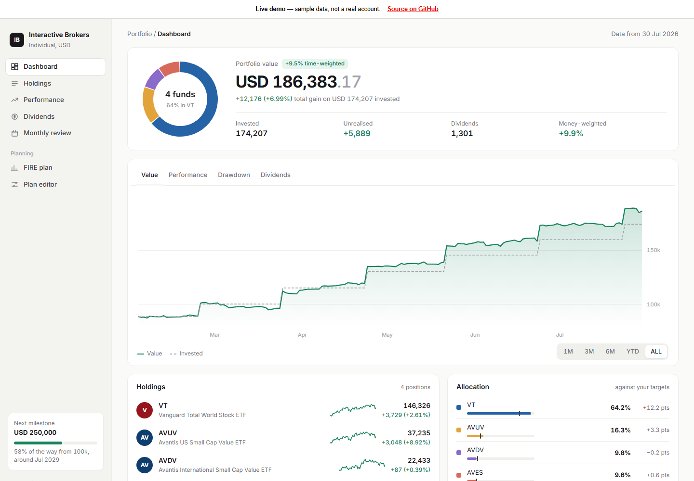

# IBKR Portfolio & FIRE Dashboard

Pulls your Interactive Brokers account, reconstructs your deposit history, computes
**money-weighted returns**, and writes a single self-contained interactive HTML file.

Everything personal lives in `config.json` — your account, goals, savings phases and
target allocation. The code has nothing about you in it.

## ▶ Try it — [live demo](https://jmp1909.github.io/ibkr-dashboard/)

**[jmp1909.github.io/ibkr-dashboard](https://jmp1909.github.io/ibkr-dashboard/)** — the real
dashboard running on sample data. Drag the sliders, hover the charts. Nothing to install, and
no account involved.

[](https://jmp1909.github.io/ibkr-dashboard/)

## What it shows

An app with a side menu and seven pages:

| Page | |
|---|---|
| Dashboard | Portfolio value with a holdings donut, a chart of value, return vs VT, drawdown and dividends (range 1M to ALL), holdings with three-month trend lines, allocation against your targets, the next purchase, and your FIRE age |
| Holdings | Every position with cost, gain, weight against target and fund cost; where the money really is after fund look-through; a buy-only planner for your next contribution |
| Performance | Time- and money-weighted returns, you vs VT (total return), returns by window, a monthly heatmap with best and worst months and recovery, deposits, what fund fees cost you by retirement, and the currency split |
| Dividends | Totals, yield, estimated withholding, per month, per fund and every payment |
| Monthly review | Any month at a glance: what you paid in, what markets did, dividends, how far you got towards the target, and whether you saved what the plan said |
| FIRE plan | The projection from your actual history into the future, with the range of 500 simulated markets, one-off events, coast FIRE and independence marked; key ages, simulation odds, yearly flows, a what-if grid and milestones |
| Plan editor | A draggable timeline of life phases and one-off events, the phases, events and Swiss pensions, with the result updating beside it |

Charts have hover readouts, legends double as switches, and the page remembers where you were.
The output is one HTML file with no external dependencies beyond a web font, so you can email
it to yourself or open it offline.

## Requirements

- **Python 3.10+**
- **A Java runtime** (JRE 8u192 or later) — needed by IBKR's gateway, not by this project.
  [Eclipse Temurin](https://adoptium.net) works.
- **An Interactive Brokers account.**

## Setup

```
git clone https://github.com/jmp1909/ibkr-dashboard.git
cd ibkr-dashboard
python -m venv .venv
.venv\Scripts\python.exe -m pip install -r requirements.txt
```

Try it with bundled sample data — no IBKR account or gateway needed:

```
.venv\Scripts\python.exe src\main.py --demo
```

That writes `dashboard.html`. If it looks right, set up live data.

## Configure

Copy `config.example.json` to `config.json`, then edit it:

| Block | Required | What it controls |
|---|---|---|
| `person.birth_date` | yes | Drives every age on the projection |
| `goal.target` | yes | The number you're aiming at |
| `goal.real_return` | yes | Assumed return after inflation and fees |
| `goal.withdrawal_rate` | yes | Sets the income your target funds |
| `goal.coast_full_age` | yes | Age the coast portfolio must reach the target by, unaided |
| `goal.target_mode` | no | `amount` (default) uses `target`; `spending` sets target = `annual_spending` ÷ `withdrawal_rate` |
| `goal.annual_spending` | no | Yearly spending in retirement, for `spending` mode |
| `goal.volatility` | no | Yearly volatility for the uncertainty band. Default 0.16 |
| `goal.plan_to_age` | no | How far the projection runs. Default 95 |
| `goal.milestones` | no | Explicit milestone ladder. Omit it and one is generated to fit your target |
| `phases[]` | yes | Your savings timeline — see below |
| `events[]` | no | One-off lump sums: a bonus, an inheritance, or a purchase (negative) |
| `targets` | no | Intended allocation. Must sum to 1. Omit to hide the drift section |
| `lookthrough` | no | Regional split inside each fund, from its factsheet, plus `ter` (expense ratio) for the fee comparison |
| `benchmark.ticker` | no | Benchmark on the Dashboard and Performance pages, as total return. Default VT; null hides it |
| `dividends.withholding_rate` | no | Estimated tax withheld at source. Default 0.15 |
| `scenarios` | no | Named what-ifs stored as changes from the plan, see Scenarios below |
| `pensions` | no | Swiss pillar 2 / 3a pots and AHV — see below. Off by default |
| `currency_basket` | no | Currencies held *inside* each fund — not the one it's priced in |
| `currency.enabled` | no | Set false if your funds report in the currency you spend |
| `account.display_currency` | yes | The currency your figures are shown in — see the note below |
| `output.locale` | no | Number formatting, e.g. `en-US` → 1,234,567 · `de-CH` → 1'234'567 · `de-DE` → 1.234.567 |

### A note on currency

`display_currency` **labels** your figures; it does not convert them. IBKR reports your
account in whatever base currency the account itself is set to, and that's the number this
tool receives. So set `display_currency` to match your IBKR base currency — if they
disagree the run prints a warning, because otherwise you'd be reading one currency's
numbers under another's name. To genuinely change the currency, change the account's base
currency in IBKR.

Separately, `currency.asset_currency` is the currency your *funds report in* (often USD).
When that differs from what you spend, the Performance page splits your return into what the
investments did and what the exchange rate did.

### Phases

`phases[]` is a list of any length. Each entry is a period with its own income and saving,
so it fits whatever your life actually looks like — not a fixed student → career
template. A promotion, a lower savings rate, a career break: each is just another phase.

```json
{ "id": "break", "label": "Career break", "start": "2032-01", "end": "2032-12",
  "monthly_income": 0, "savings_rate": 0.0, "income_growth": 0.0 }
```

A phase saves either a share of its income (the default: `monthly_income * savings_rate`)
or a fixed amount regardless of income:

```json
{ "id": "masters", "label": "Master's", "start": "2027-09", "end": "2029-06",
  "monthly_income": 900, "saving_mode": "fixed", "monthly_saving": 250 }
```

`end: null` means open-ended. `income_growth` is real annual growth above inflation, counted
from the later of the phase's start and today. Phases **can't overlap** — each month
belongs to at most one — and a gap between phases simply saves nothing. Phases that have
already ended are ignored by the projection but kept, so you can leave them as a record.

The projection always starts from the month of your latest data. A phase that began earlier
shows as starting "now".

### One-off events

```json
"events": [
  { "date": "2030-06", "label": "Inheritance", "amount": 20000 },
  { "date": "2035-03", "label": "Flat deposit", "amount": -60000 }
]
```

### Life after retirement

When the portfolio reaches the target the plan stops saving and starts withdrawing what the
target was sized to pay (`target × withdrawal_rate` a year, in today's money). The dashboard
shows how long that lasts, and how long it lasts if markets fall 30% in the month you retire —
the sequence-of-returns risk a steady-return line hides.

### Uncertainty band

The shaded band is the middle 80% of 500 simulated markets: random monthly returns with your
real return as the median and `goal.volatility` as the spread. It also gives the age by which
half, and nine in ten, of those markets reach the target, and how often the money lasts to
`plan_to_age`. The simulation is seeded, so the band is the same every time you load the page.
Months are independent, which is kinder than real markets in long slumps.

### Swiss pensions

Optional and off by default:

```json
"pensions": {
  "enabled": true,
  "pillar2":  { "balance": 30000, "yearly_contribution": 6000, "real_return": 0.01, "unlock_age": 65 },
  "pillar3a": { "balance": 10000, "yearly_contribution": 7000, "real_return": 0.03, "unlock_age": 60 },
  "ahv":      { "yearly_amount": 22000, "start_age": 65 }
}
```

Pillar 2 and 3a pots grow at their own real return, take contributions until you retire, and are
paid into the portfolio at `unlock_age` (3a can be drawn from five years before the AHV reference
age of 65). AHV is a yearly pension from `start_age` that reduces what the portfolio has to pay
out. Take the figures from your own pension statements; the dashboard does not model tax or
annuity conversion.

### Scenarios

**Base** is always your `config.json` and is never changed from the page. Change anything on the
FIRE plan page or in the plan editor and it becomes a scenario ("My edits"); **+ New scenario**
copies what is on screen into another one. The scenario bar lists every change from Base, each
with its own undo, and you can show any other scenario as a dashed line to compare. Scenarios
are kept in your browser; **Copy as config** gives either the whole plan or just the scenario's
changes, in this format:

```json
"scenarios": [
  { "name": "Promotion at 35", "overrides": { "phases": { "senior": { "monthly_income": 9500 } } } }
]
```

Overrides can set any `goal` value, any `pensions` value (e.g. `"pillar3a.balance"`), any field
of a phase by its `id`, and can `add_phases`, `remove_phases`, `add_events` or `remove_events`.
If `config.json` changes after you made a scenario, the page says so and offers to re-apply the
scenario's changes on top of the new version.

### Editing the plan on the dashboard

You don't have to edit JSON. In the **Plan editor** (goal values are on the **FIRE plan** page):

- **Drag** a phase's edges to change when it starts and ends, or drag the middle to move it.
  Where two phases touch, the shared edge moves both; nothing can be moved into the past.
  Arrow keys work too (Shift moves a year). The timeline shows the next 10 years by default
  so short phases are wide enough to grab — switch to 5, 20 or all.
- **Add phase** splits the open-ended last phase; **×** removes one and lets its neighbour
  take over the freed months. Each phase can be renamed and switched between "% of income"
  and "fixed amount" without its current saving jumping.
- **One-off events** are diamonds on the timeline; drag them, or edit name and amount below.

Every edit lands in the active scenario (see Scenarios above), kept in your browser across
reloads. Nothing touches `config.json` until you copy it there yourself; switching back to
**Base** shows `config.json` as it is.

### Sections that disable themselves

The dashboard hides what it can't describe honestly, so a minimal config still produces a
clean page:

- **no `targets`** → the drift and next-buy section disappears
- **no `lookthrough` entry for your holdings** → the regional exposure panel disappears
  rather than inventing a split
- **no `currency_basket` entry** → the currency-denomination panel disappears
- **`currency.enabled: false`**, or assets and spending in the same currency → the whole
  currency section disappears

The bundled `lookthrough` and `currency_basket` values describe one specific set of ETFs
(VT and some Avantis funds). **If you hold different funds, replace them** — otherwise
those panels describe someone else's portfolio rather than yours.

## Live data

IBKR has no simple REST API. You run a local gateway that proxies authenticated requests.

1. Download the [Client Portal Gateway](https://download2.interactivebrokers.com/portal/clientportal.gw.zip).
2. Unzip it so `clientportal.gw` sits **next to this project folder** (or set
   `IBKR_GATEWAY_HOME` to wherever you put it).
3. Create the one-click launcher:

```
powershell -ExecutionPolicy Bypass -File scripts\create_shortcut.ps1
```

That puts **Refresh Dashboard** on your Desktop. Double-click it and it will:

- clear any leftover gateway processes and start a clean one
- open your browser at `https://localhost:5000` for you to log in
- wait for you, pull your data, write `dashboard.html`, and shut the gateway down again

You log in yourself — the script never handles your credentials.

> **Sessions expire after roughly 24 hours** and re-authentication needs a browser. That's
> IBKR's design and no script can work around it. For a genuinely unattended pull, IBKR's
> Flex Query route (scheduled statements delivered by token) is the only reliable option —
> end-of-day only, which for a buy-and-hold portfolio is usually fine.

### Without the launcher

```
cd clientportal.gw
bin\run.bat root\conf.yaml
```

Leave that running, log in at `https://localhost:5000`, then:

```
.venv\Scripts\python.exe src\main.py
```

## Dividends and the benchmark

IBKR's transaction feed reports dividends **gross** — on real data they match the per-share
payout times shares held to the cent — and doesn't report the tax withheld. The net figures
are therefore an estimate at `dividends.withholding_rate`; your statement has the exact amount.

The benchmark is a **total-return** index: built from daily closes with each distribution
(which IBKR returns alongside the prices) reinvested on its ex-date. A price-only line would
understate a fund like VT by its yield, roughly 2 points a year. When the currency section is
on, it is converted with the same daily rates as your return, so both lines are in one currency.

## How the returns are computed

IBKR reports time-weighted return, which deliberately ignores deposits and withdrawals.
That answers "how did the funds do", not "how did *my money* do" — and while you are
contributing heavily those differ a lot.

So the external cash flows are recovered from the NAV and return series:

```
flow_t = NAV_t - NAV_t-1 * (1 + r_t)
```

Any change in value that the day's return does not explain must be a transfer. An internal
rate of return is then solved over those flows. Replaying the reconstructed flows forward
reproduces the final NAV exactly, which is a reasonable check that the reconstruction is
sound — worth re-checking on your own data rather than trusting it blindly.

`data/nav_history.json` accumulates every pull, because IBKR's performance endpoint only
reaches back about a year — the 3- and 5-year windows fill in on their own over time.

## Notes

- `--demo` uses a separate history file, so experimenting never touches real data.
- `--no-open` skips launching the browser; `-v` gives verbose logging.
- Windows-only launcher. The Python side is cross-platform; on macOS/Linux run
  `bin/run.sh root/conf.yaml` and `python src/main.py` yourself.
- The main projection line uses a constant real return; the band and the crash test show
  how much that matters. Nothing models tax. They show the shape of the problem, not a
  forecast.
- Risk figures come from the time-weighted series, so deposits never count as gains. With a
  short history they are indicative only.

**Not investment advice.** The allocator does arithmetic against targets *you* set; it
never suggests selling, and it knows nothing about your circumstances.

## Licence

MIT
